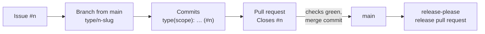

# Contributing

Every change to Argus must be traceable to an issue. These conventions apply to people and to AI agents alike, and most of them are checked by CI ([`docs/ci.md`](docs/ci.md)).

## The workflow at a glance



1. Pick or open an [issue](#issues).
2. Create a [branch](#branches) from an up-to-date `main`.
3. Commit following [Conventional Commits](#commits).
4. Open a [pull request](#pull-requests) early, as a draft if the work is not finished.
5. Merge once the required checks are green and the [Definition of Done](#definition-of-done) holds.

## Branching model

Argus uses **trunk-based development** (GitHub Flow): `main` is the only long-lived branch, and every change reaches it through a short-lived branch and a pull request. There is no `develop` branch.

### Why there is no `develop` branch

A `develop` branch (GitFlow) integrates work before it is stabilised and released from `main`. Here it would add a second branch to keep in sync without solving a real problem:

- **Releases are cut from `main`.** release-please reads the Conventional Commits merged into `main` and opens the release pull request from them (see [`docs/ci.md`](docs/ci.md#releaseyml-versions-and-releases)). With `develop`, every release would need an extra `develop → main` merge, and the changelog would have to be computed on one branch and published from the other.
- **Bots and CI target the default branch.** Dependabot pull requests, the required checks of the [ruleset that protects `main`](docs/ci.md#protection-of-main) and the nightly pipeline all work on `main`. A second integration branch would need its own protection and configuration, and could drift from `main`.
- **The pull request already does the integration.** Branches are short and tied to one issue, and the checks run on the result of merging the branch into `main`. That is the job a `develop` branch does in larger teams.
- **`main` is always releasable.** The goal is continuous deployment to AWS: what is in `main` must build, pass every check and be ready to deploy. GitFlow is designed around scheduled releases with `release/*` and `hotfix/*` branches, which this project does not have.
- **Progress stays visible in `main`.** Pull requests are merged with a merge commit, so every commit shows up in `main`. With `develop` in between, `main` would only show release merges.

**When to reconsider.** A `develop` branch (or release branches) would make sense if Argus had to maintain several versions in production at the same time, or if a staging environment had to validate a batch of changes before they are released. If that happens, record the change as an ADR that supersedes [ADR 0013](docs/adr/0013-trunk-based-development-without-a-develop-branch.md) and update this guide.

## Issues

Work is tracked in the [Argus Quant Engine project](https://github.com/users/MeSeeFoo/projects/1) as a three-level hierarchy, linked as GitHub sub-issues:

| Level | What it is | Title | Labels |
| :--- | :--- | :--- | :--- |
| **Epic** | A phase of the [roadmap](docs/roadmap.md): the feature, described functionally, with the phase's "done when" | `[Epic] Phase 2 · Vertical slice` | `epic`, phase |
| **Story** | A functional increment for a real user (analyst, operator, developer), never for a component. Sub-issue of the epic | `[2.1] Live BTCUSDT market data on the fast path` | `story`, phase, area |
| **Task** | A technical unit of work that ends in one branch and one pull request. Sub-issue of its story | `[2.1.1] Scaffold argus-feed-gateway` | `task`, phase, area |

- **Numbering.** A story takes the next number of its phase (`[2.1]`) and its tasks the next sub-number (`[2.1.1]`). A follow-up found while working on a task becomes a new task of the same story. Work that belongs to no story, such as process changes, is a task directly under the epic (`[2.0]`).
- **Templates.** **Story** (as a… I want… so that…, acceptance criteria in Given/When/Then, tasks), **Task** (context, scope, acceptance criteria) or **Bug** (what happens, what should happen, how to reproduce). Blank issues are disabled.
- **Labels.** Every issue gets its phase (`phase:0`, …) and its level (`epic`, `story`, `task`, or `bug`). Stories and tasks also get their area: a service (`feed-gateway`, …) or `build`, `ci`, `contracts`, `docs`, `infra`, `quality`.
- **One task, one branch, one pull request.** Work found along the way that is not in the scope goes in a new task.
- **Closing.** A task closes when its pull request is merged. A story closes when all its tasks are closed and its acceptance criteria have been verified, ticking each box. The epic closes when its "done when" holds.

Phases 0 and 1 predate stories: their tasks hang directly from the epic, and their follow-ups took the next sub-number of a task (`[0.7.12]`).

## Branches

- Created from an **up-to-date `main`**, named `<type>/<issue>-<slug>`:
  - `type` is one of the [commit types](#commits) below.
  - `issue` is the issue number.
  - `slug` is a few lowercase words separated by hyphens.
  - Examples: `feat/1-maven-build`, `ci/37-line-endings-check`, `docs/10-repository-conventions`.
- `main` cannot receive direct pushes: every change goes through a pull request.
- If `main` moves on before the merge, bring the branch up to date by **merging `main` into it**. Do not rebase or force-push a branch that is already pushed: existing commits are never rewritten.
- Delete the branch once the pull request is merged.

The `Conventions` check rejects a branch name that does not match. Branches opened by Dependabot and release-please are exempt.

## Commits

Commits follow [Conventional Commits](https://www.conventionalcommits.org/) and end with the issue they belong to:

```text
<type>(<optional scope>): <description> (#<issue>)
```

```text
feat(build): add parent POM (#1)
fix(ci): run the Maven Wrapper from the current directory on Windows (#29)
docs: document Kafka topic provisioning (#7)
```

| Type | Use for | In the changelog |
| :--- | :--- | :--- |
| `feat` | A new capability | Features |
| `fix` | A bug fix | Bug fixes |
| `perf` | A performance improvement | Performance |
| `refactor` | A change that neither fixes a bug nor adds a capability | Refactoring |
| `revert` | Reverting a previous commit | Reverts |
| `docs` | Documentation only | Documentation |
| `build` | The build, dependencies, Docker images | Build |
| `ci` | GitHub Actions workflows and CI configuration | Continuous integration |
| `test` | Tests only | Hidden |
| `style` | Formatting, no change in behaviour | Hidden |
| `chore` | Maintenance that fits nowhere else | Hidden |

- **Scope** (optional) is the area or module: `build`, `ci`, `infra`, `contracts`, `deps`…
- **Description** in the imperative, lowercase, without a final period: "add", not "added" or "adds".
- **Breaking changes** add `!` after the type or scope (`feat(contracts)!: …`) and explain the break in a `BREAKING CHANGE:` footer.
- **One logical change per commit.** The history of `main` is how progress is followed, so commits should read well on their own.
- The type decides the next version: see [`docs/ci.md`](docs/ci.md#releaseyml-versions-and-releases).

## Pull requests

- **Title:** a Conventional Commit ending with the issue, like a commit: `feat(build): add parent POM (#1)`. The `Conventions` check validates it, and editing the title runs it again.
- **Description:** fill in the template: a summary of the changes, `Closes #n` so that the issue closes on merge, and how it was tested.
- **Open it early**, as a draft if the work is not finished: nothing runs on a branch without a pull request.
- **Merge** only with the required checks green and the branch up to date with `main` (both enforced by the ruleset).
- **Merge commit only.** Squash and rebase merges are disabled, so every commit of the branch stays visible in `main` and is read by release-please for the changelog.

## Definition of Done

A task is done when:

- [ ] Every acceptance criterion of the issue is met, and its boxes are ticked.
- [ ] `./mvnw verify` passes locally: build, tests, formatting, static analysis and coverage thresholds.
- [ ] New behaviour is covered by tests; bugs get a test that fails without the fix.
- [ ] Documentation reflects the change: README, `docs/`, module READMEs and comments where behaviour changed.
- [ ] Significant design decisions are recorded as an ADR in [`docs/adr`](docs/adr/README.md).
- [ ] No `TODO` without an issue number.
- [ ] The pull request is merged with every required check green, the issue is closed and the branch is deleted.

## Editor and formatting

- [`.editorconfig`](.editorconfig) sets the encoding, line endings, final newline and indentation for every file type. Most IDEs apply it automatically (IntelliJ IDEA and VS Code with the EditorConfig extension).
- Java code is formatted with google-java-format through Spotless: `./mvnw spotless:apply` fixes it, and `verify` fails on unformatted code.
- [`.gitattributes`](.gitattributes) stores every file with LF line endings, except `.cmd` and `.bat` files, which are checked out with CRLF. The `Line endings` check enforces it.
