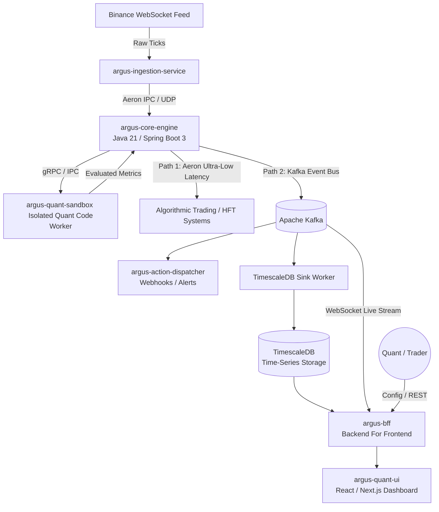

# Argus Quant Engine

> **High-Performance Financial Quantitative Engine, Event Streaming, and Automated Rule Evaluation Platform.**

---

## 📋 Overview

**Argus Quant Engine** (`argus-quant-engine`) is an institutional-grade, distributed quantitative finance and event-driven processing framework built from scratch using **Java 21**, **Spring Boot 3**, **Aeron**, and **Apache Kafka**. 

Inspired by real-world Capital Markets (CIB) architectures (such as high-throughput trading, algorithmic execution pipelines, and real-time monitoring systems), this project serves as a technical portfolio piece demonstrating advanced backend engineering, strict hexagonal architecture, ultra-low-latency patterns, and isolated code execution sandboxes.

---

## 🏗️ Architectural Vision & Microservices Layout

To mirror a production-grade enterprise environment, the platform is fully decoupled into specialized, containerized microservices communicating via a **Dual-Path Streaming Architecture**:
1. **Aeron (IPC/UDP):** Used for ultra-low-latency paths where speed is mission-critical (e.g., streaming raw market data and routing signals directly to trading algorithms).
2. **Apache Kafka:** Used for event distribution, durability, and decoupling non-critical consumers (e.g., analytics, historical persistence, and frontend UI dashboards).

### System Architecture Diagram

## 🧩 Microservices Components

| Microservice / Component | Tech Stack | Responsibility |
| :--- | :--- | :--- |
| **`argus-ingestion-service`** | Spring Boot 3, WebSockets | Connects to external market feeds (e.g., Binance public WebSockets), normalizes raw market data, and pushes ticks into the pipeline. |
| **`argus-core-engine`** | Java 21, Spring Boot 3 | The heart of the system. Manages sliding time windows (using Java 21 Sequenced Collections), executes real-time indicators, and evaluates custom quantitative rules. |
| **`argus-quant-sandbox`** | Isolated Container / GraalVM | A secure worker service where custom quant scripts and indicators are executed safely without risking core engine stability. |
| **`argus-action-dispatcher`** | Spring Boot 3, Resilience4j | Asynchronously consumes alert events from Kafka and dispatches automated actions (webhooks, notifications). |
| **`argus-bff`** | Spring Boot 3, WebSockets | Backend For Frontend. Exposes management REST APIs, queries historical databases, and streams real-time updates to the UI via WebSockets. |
| **`argus-quant-ui`** | React / TypeScript, Tailwind | Real-time dashboard to monitor market feeds, visualize charts, configure indicators, and manage quantitative rules. |
| **Persistence & Messaging** | Apache Kafka, Aeron, TimescaleDB | Aeron for sub-millisecond inter-process messaging; Kafka for durable event streaming; TimescaleDB for high-performance time-series financial data. |
