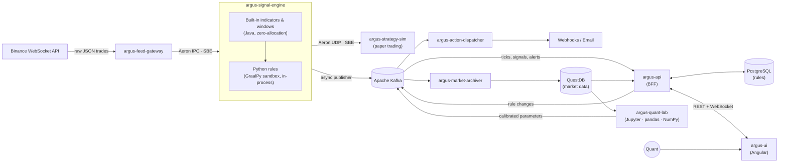

# Argus Quant Engine

[](https://github.com/MeSeeFoo/argus-quant-engine/actions/workflows/ci.yml)

> **Event-driven quantitative engine: real-time market data, low-latency signal generation, sandboxed Python rules, a quant research lab, and a cloud-native deployment on AWS.**

> [!NOTE]
> 🚧 **Status: design phase.** This README describes the target architecture. See the [Roadmap](#-roadmap) for what is built so far.

---

## 📋 Overview

**Argus Quant Engine** is a self-learning portfolio project that rebuilds, at small scale, the kind of pipelines found in Corporate & Investment Banking (CIB) trading platforms. It ingests live market data, computes indicators and evaluates quantitative rules in real time, and distributes the results through two paths: a **low-latency path** (Aeron) for trading consumers and a **durable path** (Kafka) for persistence, alerting and the UI.

The project focuses on three engineering topics:

1. **Low-latency design on the JVM:** single-threaded agents, zero-allocation hot paths, binary encoding (SBE) and shared-memory messaging (Aeron IPC).
2. **Hexagonal architecture:** pure domain models with no framework dependencies, with the architecture rules enforced by tests.
3. **Safe execution of user code:** trading rules are written by users in **Python** and run **inside the engine process** with GraalPy, isolated by the GraalVM Polyglot sandbox. Heavier research and model calibration happen offline in a separate Python lab with pandas and NumPy.

The whole platform runs locally with Docker Compose and is deployed **end-to-end on AWS** with Terraform.

### Goals

- Build an end-to-end pipeline that works, from the exchange feed to the dashboard.
- Measure latency honestly (HdrHistogram, JMH) instead of claiming it.
- Practise production concerns: schemas and contracts, observability, CI/CD, infrastructure as code.

### Non-goals

- **No real order execution.** Trading consumers are simulated (paper trading).
- It is not an Order Management System (OMS) and does not offer production-grade HA or disaster recovery.
- No co-location or kernel-bypass networking. The market feed comes over the public internet, so end-to-end latency is dominated by the exchange connection. Latency targets apply **inside the pipeline**.

---

## 🏗️ Architecture

### Dual-path streaming

| Path | Transport | Encoding | Used for |
| :--- | :--- | :--- | :--- |
| **Fast path** | Aeron (IPC within a host, UDP unicast between hosts) | SBE (Simple Binary Encoding) | Ticks into the engine, and signals out to trading consumers |
| **Durable path** | Apache Kafka | Protobuf + Schema Registry | Archiving, alerting, rule distribution, UI streaming |

The engine never blocks on Kafka. Results are written to an in-memory Agrona ring buffer, and a dedicated publisher thread drains it into Kafka. Slow brokers or consumers therefore cannot affect the fast path. The trade-off is accepted on purpose: if the ring buffer fills up, messages are dropped rather than slowing the engine down (see [Market data on Kafka](#market-data-on-kafka)).

### System diagram



---

## 🧩 Components

| Component | Type | Tech | Responsibility |
| :--- | :--- | :--- | :--- |
| **`argus-feed-gateway`** | Service | Spring Boot, Java WebSocket client, Aeron | Connects to Binance public streams, normalises trades into SBE messages and publishes them over Aeron. Handles reconnection and sequence-gap detection. A replay mode feeds Binance's public historical data instead, for reproducible tests and benchmarks. |
| **`argus-signal-engine`** | Service | Spring Boot (bootstrap only), Aeron, Agrona, GraalVM Polyglot | Core of the system. Maintains in-memory sliding windows sized by what each rule declares (for example its timeframe), computes built-in indicators, and evaluates the users' Python rules in the embedded sandbox. Emits signals over Aeron, and publishes every market tick and signal to Kafka. |
| **`argus-rule-runtime`** | Library | GraalVM Polyglot (GraalPy), `argus` Python SDK | Sandboxed execution of Python rules, embedded in the signal engine. Provides the `argus` SDK (`@rule`, indicators, `argus.math`), applies isolation and resource limits, and manages the rule lifecycle. |
| **`argus-strategy-sim`** | Service | Spring Boot, Aeron | Reference fast-path consumer. Subscribes to signals, simulates order fills and tracks a paper portfolio. It also records the signal-to-reaction latency. |
| **`argus-action-dispatcher`** | Service | Spring Boot, Resilience4j | Consumes alert events and runs actions (webhooks, email) with retries, circuit breakers and a dead-letter topic. |
| **`argus-market-archiver`** | Service | Spring Boot, Spring Kafka, QuestDB Java client (ILP) | Persists every trade and top-of-book update, plus signals and alerts, into QuestDB time-partitioned tables, in batches. |
| **`argus-api`** | Service | Spring Boot, Spring Security (OAuth2), WebSocket | Backend-for-Frontend. Rule management (CRUD, validation, versioning), historical queries, and live streaming of Kafka events to the UI. Chart candles are computed on request from the ticks in QuestDB (`SAMPLE BY`), at the resolution the user picks. |
| **`argus-ui`** | Web app | Angular, TypeScript, TradingView Lightweight Charts | Real-time dashboard: live charts, signals and alerts, plus a Python rule editor. |
| **`argus-quant-lab`** | Research environment | Python (CPython), Jupyter, pandas, NumPy, SciPy | Offline research on the data stored in QuestDB: analysis, backtesting and model calibration. Publishes calibrated parameters for live rules to Kafka. |
| **`argus-contracts`** | Library | SBE schemas, Protobuf | Single source of truth for all message contracts. Generates the codecs used by every service. |

---

## ⚡ Inside the signal engine

### Hot path

- **Single-threaded agents** (Agrona `AgentRunner`), each pinned to its own thread with a busy-spin or back-off idle strategy. Locks are never taken on the hot path.
- **Zero allocation in steady state.** Windows are pre-allocated primitive ring buffers (no boxed collections). SBE flyweights decode messages without creating objects. Allocation rate is checked with JFR.
- **Kafka is decoupled** through an Agrona ring buffer and a separate publisher agent (see above).
- **GC:** Generational ZGC, so that the remaining pauses stay short.

### Python rules

Trading rules are plain **Python** functions. There is no custom rule language: users get the full expressiveness of Python, plus a small `argus` SDK.

```python
from argus import rule, Signal

@rule(symbols=["BTCUSDT"], timeframe="1m", actions=["webhook:telegram"],
      params={"rsi_threshold": 30})
def oversold_in_uptrend(ctx, params):
    # ctx.rsi() and ctx.sma() are computed in Java on the fast path;
    # the Python rule only combines them and decides.
    if ctx.rsi(14) < params.rsi_threshold and ctx.close > ctx.sma(200):
        return Signal.long(strength=0.8)
```

- **`@rule` metadata** (symbols, timeframe, actions, parameters) is read when the rule is loaded. The engine uses it to know which indicators to maintain and how much history each window must keep, and the UI uses it to display the rule.
- **Built-in indicators** (SMA, EMA, RSI, ATR, VWAP, Bollinger bands…) are implemented in Java and exposed to Python as read-only views, so the expensive work stays on the zero-allocation path.
- **Incremental maths in pure Python** (z-scores, rolling regressions, Kalman filters, GARCH updates…) runs well: GraalPy JIT-compiles pure Python code.
- **`argus.math`:** vetted numerical functions (for example linear algebra and statistics) implemented in Java and explicitly exposed to the sandbox. This replaces NumPy, which cannot run inside the sandbox.
- **Model calibration** (fitting a GARCH, training a model, optimising parameters) belongs in [`argus-quant-lab`](#-components). The lab publishes the calibrated `params`, and the live rule only applies them.

### Embedded sandbox (GraalPy)

Rules run **in-process** through the GraalVM Polyglot API, with GraalPy as the Python runtime. There is no network hop and no serialisation on the evaluation path.

- **Isolation:** rules run in a polyglot context with no host access beyond the `argus` SDK, no I/O, no threads and **no native code**, configured through GraalVM's `SandboxPolicy`. The stronger policies (`ISOLATED`, `UNTRUSTED`) run code in a separate isolate heap and need the language's isolate artifact (`python-isolate`). The exact policy supported by GraalPy is validated with a proof of concept at the start of Phase 3.
- **Resource limits:** per-evaluation limits on statements, CPU time and heap.
- **Warm-up:** GraalPy needs to warm up before its JIT kicks in. New or updated rules are first run against recent historical data (replay) and only activated once warmed up.
- **Fault containment:** rules run on their own evaluator agent, so a slow rule cannot stall the built-in indicators. If a rule fails repeatedly or exceeds its budget, it is disabled (circuit breaker) and an alert is raised. The engine keeps running.
- **Why not pandas or NumPy here:** they are C extensions, so they cannot run under a sandbox that forbids native code. pandas is also designed for batch processing, not for per-trade updates.

### Rule lifecycle

1. A rule is created and validated through `argus-api` (syntax check, `@rule` metadata, a dry run in the sandbox) and stored, versioned, in PostgreSQL.
2. It is published to the **compacted** Kafka topic `argus.rules.v1`. Calibrated parameters from the quant lab arrive through `argus.rule-params.v1`.
3. The signal engine consumes both topics, warms up the new version, and swaps in an immutable rule set **outside the hot path**. On restart, it rebuilds its full state from the compacted topics.

### Where Spring is (and is not) used

Spring Boot is used in every service for configuration, lifecycle, health checks (Actuator), metrics and the Kafka and REST adapters. **In the signal engine, Spring only wires and starts the agents.** The hot path runs as plain Java on dedicated threads, with no beans, proxies or reflection involved. A real ultra-low-latency system would probably drop Spring entirely. It is kept here on purpose, as a learning goal, and confined to the edges.

---

## 🔷 Hexagonal architecture

Every service follows the same structure:

```text
com.argus.<service>
├── domain        # Pure Java: models, value objects, domain logic. No Spring, no I/O.
├── application   # Use cases + ports (inbound/outbound interfaces).
├── adapter
│   ├── in        # Aeron subscribers, Kafka consumers, REST/WebSocket controllers
│   └── out       # Aeron publishers, Kafka producers, JDBC repositories, HTTP clients
└── config        # Spring wiring (the only package allowed to depend on adapters)
```

**ArchUnit** tests enforce the dependency rules in CI. For example, `domain` must not depend on Spring, Aeron or Kafka. The same rule is what keeps the signal engine's hot path free of framework code. The rules live in [`libs/architecture-rules`](libs/architecture-rules/README.md), and each service applies them with a single test class.

---

## 📨 Contracts

| Channel / Topic | Transport | Schema | Description |
| :--- | :--- | :--- | :--- |
| `aeron:ipc` stream 1001 | Aeron | SBE `Trade`, `BestBidAsk`, `Heartbeat` | Normalised market data from the feed gateway |
| `aeron:udp` stream 2001 | Aeron | SBE `Signal`, `Heartbeat` | Signals for fast-path consumers |
| `argus.market.trades.v1` | Kafka | Protobuf | Normalised trades (archive) |
| `argus.market.quotes.v1` | Kafka | Protobuf | Top of book (best bid / ask) |
| `argus.signals.v1` | Kafka | Protobuf | Signals emitted by rules |
| `argus.alerts.v1` | Kafka | Protobuf | Alerts that trigger actions |
| `argus.rules.v1` | Kafka (compacted) | Protobuf | Current Python rule definitions (source + metadata) |
| `argus.rule-params.v1` | Kafka (compacted) | Protobuf | Calibrated rule parameters from the quant lab |
| `argus.alerts.dlq.v1` | Kafka | Protobuf | Actions that failed after retries |

All messages, fast path and Kafka, are described in [`contracts/README.md`](contracts/README.md). Partitions, cleanup policy and retention of each Kafka topic are defined in [`infra/docker/kafka/topics.conf`](infra/docker/kafka/topics.conf) (see [Kafka topics](#kafka-topics)).

### Market data on Kafka

- **Every tick, never aggregated.** `argus.market.trades.v1` and `argus.market.quotes.v1` carry every trade and every top-of-book update the engine receives. Nothing is pre-aggregated: candles for charts are computed on request by `argus-api` from the ticks stored in QuestDB, and rules keep their own windows in memory. Any resolution can be derived later without reprocessing.
- **Losses are possible, and visible.** The engine never blocks on Kafka, so if the publisher's ring buffer is full, ticks are dropped instead of slowing down the fast path. This is an accepted trade-off. Every dropped message is counted in a metric, and the `sequence` field leaves a gap that consumers (and any later analysis) can detect.
- **Kafka is not the archive.** Topics have a limited retention (days). QuestDB holds the queryable history.

**Data lake (out of scope).** Because the market topics hold the full tick stream with schemas registered in Apicurio, they can be exported as they are to a data lake for batch processing, for example with Kafka Connect / MSK Connect writing Parquet or Apache Iceberg tables to S3, read later from notebooks (Spark, DuckDB, pandas). Argus does not implement this; the contracts are designed so that it can be added without changes.

---

## 🛠️ Tech stack

| Concern | Local | AWS |
| :--- | :--- | :--- |
| **Runtime** | Java 25 (LTS): Eclipse Temurin; Oracle GraalVM 25 for the signal engine | Same container images, published to Amazon ECR |
| **Framework** | Spring Boot 4 | — |
| **Fast-path messaging** | Aeron + Agrona + SBE, Media Driver sidecar, shared IPC namespace in Docker | ECS on EC2 with `ipcMode: task` (IPC is not available on Fargate). UDP unicast between hosts, because VPCs do not support multicast |
| **Event streaming** | Apache Kafka (KRaft) | Amazon MSK (managed Apache Kafka, same client APIs) |
| **Schema registry** | Apicurio Registry | Apicurio Registry on Fargate (same serializers in every environment) |
| **Time-series storage** | QuestDB | QuestDB self-managed on EC2 + EBS |
| **Relational storage** (rules) | PostgreSQL | Amazon RDS for PostgreSQL |
| **User rules** | GraalPy (GraalVM Polyglot), running on Oracle GraalVM 25 | Same image as the signal engine |
| **Research** | Python (CPython), JupyterLab, pandas, NumPy, SciPy | Runs locally; not deployed in the first AWS iteration |
| **Authentication** | Keycloak (OIDC) | Amazon Cognito (OIDC) |
| **Notifications** | Webhook mock server, MailHog | Amazon SES / outbound webhooks |
| **Frontend hosting** | `ng serve` | Amazon S3 + CloudFront |
| **API exposure** | Docker network | Application Load Balancer (REST + WebSocket) |
| **Observability** | OpenTelemetry + Micrometer → Grafana LGTM stack (`grafana/otel-lgtm`) | OpenTelemetry (ADOT collector) → Amazon CloudWatch |
| **Infrastructure as code** | Docker Compose | Terraform |
| **CI/CD** | GitHub Actions | GitHub Actions → ECR → ECS (OIDC role, no long-lived keys) |
| **Build** | Maven multi-module build (Maven Wrapper) | — |
| **Testing** | JUnit 6, Testcontainers, ArchUnit, JMH | — |

### AWS deployment overview

- **VPC** with public subnets (ALB) and private subnets (services, MSK, database).
- **ECS cluster** with two capacity types:
  - **EC2 capacity provider** for the fast path: the feed gateway, the signal engine and a Media Driver sidecar run in the same task and share IPC.
  - **Fargate** for everything else.
- **MSK** for Kafka, **EC2** for QuestDB, **RDS** for PostgreSQL, **Cognito** for authentication, **S3 + CloudFront** for the UI.
- **Region:** an EU region (for example `eu-west-1` or `eu-south-2`). Binance blocks access from some countries, including the US, so a US region would cut off the market feed.
- **Cost:** MSK and the EC2 instances are billed while they run, so the environment is meant to be created with `terraform apply` and destroyed with `terraform destroy` after each session.

---

## 📈 Performance targets

These are **targets, not measured results.** They will be replaced by real numbers (HdrHistogram percentiles) as each phase is benchmarked.

| Measurement | Scope | Target (p99) |
| :--- | :--- | :--- |
| Feed gateway → signal engine | Aeron IPC, same host | < 20 µs |
| Trade decoded → built-in indicators updated | Inside `argus-signal-engine`, Java only | < 50 µs |
| Trade decoded → signal emitted | Inside `argus-signal-engine`, simple Python rule, warmed up, sandboxed | < 500 µs |
| Engine → strategy simulator | Aeron UDP, same AZ | < 500 µs |

Cloud VMs have more jitter than dedicated hardware. Results are reported together with the environment they were measured on.

---

## 📁 Repository layout (planned)

```text
argus-quant-engine/
├── contracts/            # argus-contracts: SBE + Protobuf schemas
├── libs/
│   ├── architecture-rules/ # argus-architecture-rules (ArchUnit rules for every service)
│   └── rule-runtime/     # argus-rule-runtime (+ the argus Python SDK)
├── services/
│   ├── feed-gateway/
│   ├── signal-engine/
│   ├── strategy-sim/
│   ├── action-dispatcher/
│   ├── market-archiver/
│   └── api/
├── ui/                   # argus-ui (Angular)
├── quant-lab/            # argus-quant-lab (Python, Jupyter notebooks)
├── benchmarks/           # JMH + latency harnesses
├── infra/
│   ├── docker/           # docker-compose for local development
│   └── terraform/        # AWS infrastructure
└── docs/
    └── adr/              # Architecture Decision Records
```

---

## 🔨 Building

**Prerequisites:** JDK 25 ([Eclipse Temurin](https://adoptium.net/) recommended) with `JAVA_HOME` pointing to it. Maven itself is not required: the Maven Wrapper downloads the right version on first use.

```bash
./mvnw verify            # compile, test and check formatting
./mvnw spotless:apply    # format the code (google-java-format)
```

On Windows, use `mvnw.cmd` instead of `./mvnw`.

Notes on the build:

- **One parent POM.** Every dependency and plugin version is declared in the root [`pom.xml`](pom.xml). Modules declare dependencies without a version.
- **Toolchain checks.** The Maven Enforcer plugin fails the build with a clear message on Java older than 25 or Maven older than 3.9.
- **Formatting is enforced.** `verify` runs `spotless:check` and fails on unformatted code; run `spotless:apply` to fix it.
- **Agrona needs a JVM flag.** On Java 25, every JVM that loads Agrona (SBE codecs, Aeron) must start with `--add-exports java.base/jdk.internal.misc=ALL-UNNAMED`. The build passes it to tests through the `agrona.jvm.args` property; services must pass it at runtime.

### Continuous integration

GitHub Actions runs [`.github/workflows/ci.yml`](.github/workflows/ci.yml) on every push to `main` and on every pull request, with two jobs:

- **Build and test:** `./mvnw verify` on Linux with JDK 25 (Temurin), with the Maven repository cached between runs. A failing test, a broken architecture rule or unformatted code fails the job. The JUnit results are published as a *Test report* check on the pull request, with failing tests annotated on the code.
- **Compose smoke test:** creates `.env` from `.env.example` and runs `docker compose up -d --wait` in `infra/docker`, so it fails if any container does not become healthy within five minutes. The container logs are printed when it fails.

---

## 🐳 Local environment

The shared infrastructure runs with Docker Compose, defined in [`infra/docker/docker-compose.yml`](infra/docker/docker-compose.yml). **Prerequisite:** Docker with Compose v2 (Docker Desktop on Windows and macOS).

Run every command from `infra/docker`. The first time, create your `.env` from the template; it holds every port and credential, and is git-ignored:

```bash
cp .env.example .env
```

| Service | Host address | Notes |
| :--- | :--- | :--- |
| **Kafka** (KRaft, single node) | `localhost:9092` | Containers use `kafka:29092` |
| **QuestDB** | Console: <http://localhost:9000> · ILP: `localhost:9009` · PostgreSQL wire: `localhost:8812` | PG wire user `admin` / `quest` |
| **PostgreSQL** | `localhost:5432` | Database, user and password `argus` |
| **Apicurio Registry** | API: <http://localhost:8080/apis/registry/v3> · UI: <http://localhost:8888> | Stores its schemas in its own `apicurio` database in PostgreSQL |
| **Grafana LGTM** | Grafana: <http://localhost:3000> · OTLP: `localhost:4317` (gRPC), `localhost:4318` (HTTP) | Login `admin` / `admin`. Includes the OpenTelemetry Collector, Prometheus, Tempo, Loki and Pyroscope |

The values above are the defaults from `.env.example`. If a port is already taken on your machine, change it in `.env`.

```bash
docker compose up -d --wait   # start everything; returns once every container is healthy
docker compose ps             # status and health of each container
docker compose logs -f kafka  # follow the logs of one service
docker compose stop           # stop the containers, keep them and their data
docker compose down           # remove the containers, keep the data
docker compose down -v        # remove the containers AND the data volumes (full reset)
```

Data lives in named volumes (`argus_kafka-data`, `argus_questdb-data`, `argus_postgres-data`, `argus_grafana-data`), so it survives `down` and `up`. To start from scratch, run `docker compose down -v`. A reset is also required after changing the PostgreSQL or Apicurio credentials in `.env`, because the databases and users are only created when the PostgreSQL volume is empty.

To reset a single service, remove its container and volume, for example QuestDB:

```bash
docker compose rm -sf questdb
docker volume rm argus_questdb-data
docker compose up -d --wait
```

### Kafka topics

Kafka does not create topics on first use (`auto.create.topics.enable=false`): a producer that writes to an unknown topic fails. Every topic is defined in [`infra/docker/kafka/topics.conf`](infra/docker/kafka/topics.conf), one line per topic with its partitions, cleanup policy and retention. The `kafka-init` service runs [`create-topics.sh`](infra/docker/kafka/create-topics.sh) once Kafka is healthy: it creates the missing topics, applies the configuration to the existing ones, and becomes healthy when it is done. `docker compose up -d --wait` therefore returns only once every topic exists.

`kafka-init` stays up after provisioning, on purpose: Compose's `--wait` treats a container that exits as a failure unless another service waits for it. Services that use Kafka declare `depends_on: kafka-init: condition: service_healthy`.

To add a topic or change one, edit `topics.conf` and run it again (it is idempotent):

```bash
docker compose restart kafka-init
```

Partitions can only grow. If `topics.conf` asks for fewer partitions than a topic has, the script logs a warning and keeps the topic as it is; removing partitions means deleting the topic (or resetting Kafka with `docker compose down -v`).

---

## 🗺️ Roadmap

- [ ] **Phase 0: Foundations.** Maven multi-module build, `argus-contracts`, Docker Compose (Kafka, QuestDB, PostgreSQL, Apicurio, Grafana), GitHub Actions CI, ArchUnit rules.
- [ ] **Phase 1: AI-assisted development workflow.** `CLAUDE.md`, specialised Claude Code subagents (backend, frontend, QA automation, DevOps, reviewer), skills and hooks.
- [ ] **Phase 2: Vertical slice.** Feed gateway → signal engine (windows + SMA/EMA) → Kafka → archiver → QuestDB.
- [ ] **Phase 3: Python rules & alerts.** GraalPy proof of concept, `argus-rule-runtime` and the `argus` SDK, sandbox limits and circuit breaker, compacted rules topic, action dispatcher with Resilience4j.
- [ ] **Phase 4: Quant lab.** `argus-quant-lab` with Jupyter, pandas and NumPy on QuestDB data: analysis, backtesting and calibrated parameters for live rules.
- [ ] **Phase 5: API & UI.** `argus-api` (REST, WebSocket, OIDC) and the Angular dashboard.
- [ ] **Phase 6: Fast-path consumer & benchmarking.** `argus-strategy-sim`, JMH and HdrHistogram harnesses, real latency numbers in this README.
- [ ] **Phase 7: AWS.** Terraform modules, ECS (EC2 + Fargate), MSK, Cognito, CloudFront, CD pipeline.
- [ ] **Phase 8: Observability.** End-to-end tracing, dashboards, SLO-based alerting.

Each phase, with its scope and completion criteria, is described in [`docs/roadmap.md`](docs/roadmap.md).

Key design decisions are recorded as ADRs in [`docs/adr`](docs/adr).

---

## 📄 License

See [LICENSE](LICENSE).
