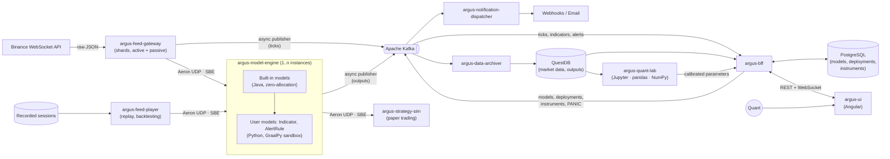

# Argus Quant Engine

[](https://github.com/MeSeeFoo/argus-quant-engine/actions/workflows/ci.yml)
[](https://sonarcloud.io/summary/new_code?id=MeSeeFoo_argus-quant-engine)
[](https://sonarcloud.io/summary/new_code?id=MeSeeFoo_argus-quant-engine)

> **Event-driven quantitative engine: real-time market data, low-latency indicators and alerts written by users in sandboxed Python, a quant research lab, and a cloud-native deployment on AWS.**

> [!NOTE]
> 🚧 **Status: design phase.** This README describes the target architecture. See the [Roadmap](#-roadmap) for what is built so far, and the [Architecture Decision Records](docs/adr/README.md) for why it looks the way it does.

---

## 📋 Overview

**Argus Quant Engine** is a self-learning portfolio project that rebuilds, at small scale, the kind of pipelines found in Corporate & Investment Banking (CIB) trading platforms. It ingests live market data, runs **models written by users in Python** (indicators and alert rules) in real time, and distributes their results through two paths: a **low-latency path** (Aeron) for trading consumers and a **durable path** (Kafka) for persistence, notifications and the UI.

The project focuses on three engineering topics:

1. **Low-latency design on the JVM:** single-threaded agents, zero-allocation hot paths, binary encoding (SBE) and Aeron messaging.
2. **Hexagonal architecture:** pure domain models with no framework dependencies, with the architecture rules enforced by tests.
3. **Safe execution of user code:** models are written by users in **Python**, loaded at runtime and run **inside the engine process** with GraalPy, isolated by the GraalVM Polyglot sandbox. Heavier research and model calibration happen offline in a separate Python lab with pandas and NumPy.

The whole platform runs locally with Docker Compose and is deployed **end-to-end on AWS** (ECS on Fargate) with Terraform.

### Goals

- Build an end-to-end pipeline that works, from the exchange feed to the dashboard.
- Measure latency honestly (HdrHistogram, JMH) instead of claiming it.
- Practise production concerns: schemas and contracts, high availability, observability, CI/CD, infrastructure as code, and the controls that regulation expects from an algorithmic trading platform.

### Non-goals

- **No real order execution.** Trading consumers are simulated (paper trading).
- It is not an Order Management System (OMS). High availability covers the feed gateway and the model engine; there is no disaster recovery across regions.
- **Low latency, not ultra-low latency.** The market feed comes over the public internet and models run in Python, so end-to-end latency is in milliseconds. Microseconds are a goal **inside the engine** only. No co-location or kernel-bypass networking.

---

## 🏗️ Architecture

### Dual-path streaming

| Path | Transport | Encoding | Used for |
| :--- | :--- | :--- | :--- |
| **Fast path** | Aeron over UDP unicast | SBE (Simple Binary Encoding) | Market data into the engine, every model output to low-latency consumers |
| **Durable path** | Apache Kafka | Protobuf + Schema Registry | Archiving, notifications, state distribution, UI streaming |

The feed gateway publishes market data on both paths, and the model engine publishes its outputs on both paths ([ADR 0027](docs/adr/0027-the-feed-gateway-publishes-market-data-on-both-paths.md)).

Neither blocks on Kafka. Messages are written to an in-memory Agrona ring buffer, and a dedicated publisher thread drains it into Kafka. Slow brokers or consumers therefore cannot affect the fast path. The trade-off is accepted on purpose: if the ring buffer fills up, messages are dropped rather than slowing the fast path down ([ADR 0005](docs/adr/0005-the-engine-never-blocks-on-kafka.md)).

Every service runs on Fargate, so Aeron uses UDP everywhere, with an embedded Media Driver in each JVM; IPC is only a configuration option ([ADR 0021](docs/adr/0021-run-everything-on-fargate-with-aeron-over-udp.md)).

### System diagram



Model state (models, deployments, the instrument catalogue, the PANIC state) is stored in PostgreSQL and distributed to the services through compacted Kafka topics ([ADR 0012](docs/adr/0012-distribute-model-state-through-compacted-topics.md)).

---

## 🧩 Components

| Component | Type | Tech | Responsibility |
| :--- | :--- | :--- | :--- |
| **`argus-feed-gateway`** | Service | Spring Boot, Java WebSocket client, Aeron | Connects to Binance public streams, normalises trades and top-of-book updates into SBE messages and publishes them over Aeron, and to Kafka without blocking the fast path ([ADR 0027](docs/adr/0027-the-feed-gateway-publishes-market-data-on-both-paths.md)). Instruments are split into **shards**; each shard runs an active and a passive task, elected through Kafka, and the passive takes over from the last trade the active published ([ADR 0022](docs/adr/0022-feed-gateway-shards-with-an-active-and-a-passive.md)). Publishes the status of its connections. |
| **`argus-feed-player`** | Service | Spring Boot, Aeron, Parquet | Replays recorded sessions with the same messages as the gateway: **backtests** (original timestamps, any speed, isolated) and **simulated live** data for instruments Binance does not list ([ADR 0024](docs/adr/0024-a-feed-player-for-replay-and-backtesting.md)). |
| **`argus-model-engine`** | Service | Spring Boot (bootstrap only), Aeron, Agrona, GraalVM Polyglot | Core of the system. Runs **deployments** of user models (`Indicator` and `AlertRule`): keeps their windows in memory, evaluates them on every input update, and emits `IndicatorValue` and `Alert` messages over Aeron and to Kafka. Instances share the deployments through a Kafka consumer group ([ADR 0014](docs/adr/0014-one-model-engine-for-alert-rules-and-indicators.md), [0016](docs/adr/0016-distribute-deployments-with-a-kafka-consumer-group.md)). |
| **`argus-model-runtime`** | Library | GraalVM Polyglot (GraalPy), `argus` Python SDK | Sandboxed execution of Python models inside the model engine: the `argus` SDK (`ModelConfiguration`, indicator views, `argus.math`), isolation and resource limits ([ADR 0011](docs/adr/0011-user-models-in-python-on-graalpy.md)). |
| **`argus-builtin-models`** | Library | Java | Standard indicators (SMA, EMA, VWAP, mid price, RSI, Bollinger…), zero-allocation, behind the same contract as Python models ([ADR 0015](docs/adr/0015-built-in-models-in-java-behind-the-same-contract.md)). |
| **`argus-strategy-sim`** | Service | Spring Boot, Aeron | Reference fast-path consumer. Subscribes to model outputs, simulates order fills and tracks a paper portfolio. It also records the output-to-reaction latency. |
| **`argus-notification-dispatcher`** | Service | Spring Boot, Resilience4j | Turns alerts into notifications (webhooks, email): routing, deduplication, cooldown, retries, a circuit breaker per destination and a dead-letter topic. It **only notifies**; it never acts on Argus ([ADR 0020](docs/adr/0020-the-notification-dispatcher-only-notifies.md)). |
| **`argus-data-archiver`** | Service | Spring Boot, Spring Kafka, QuestDB Java client (ILP) | Persists every trade and the conflated top of book, plus indicator values, alerts, notification deliveries and the audit log, into QuestDB time-partitioned tables, in batches. |
| **`argus-bff`** | Service | Spring Boot, Spring Security (OAuth2), WebSocket | Backend-for-Frontend. Management of models, deployments and the instrument catalogue (validation, versioning, dry runs), the PANIC button, historical queries, and live streaming of Kafka events to the UI. Chart candles are computed on request from the ticks in QuestDB (`SAMPLE BY`). |
| **`argus-ui`** | Web app | Angular, TypeScript, TradingView Lightweight Charts | Real-time dashboard: live charts, indicators and alerts, a Python model editor, deployments, gateway status and the PANIC button. |
| **`argus-quant-lab`** | Research environment | Python (CPython), Jupyter, pandas, NumPy, SciPy | Offline research on the data stored in QuestDB: analysis, backtesting and model calibration. Sends calibrated parameters to deployments through the BFF. |
| **`argus-contracts`** | Library | SBE schemas, Protobuf | Single source of truth for all message contracts. Generates the codecs used by every service. |
| **`argus-architecture-rules`** | Library | ArchUnit | The hexagonal architecture rules, applied by every service with a single test class. |

---

## ⚡ Inside the model engine

### Models, deployments and outputs

| Concept | What it is | Example |
| :--- | :--- | :--- |
| **Model** | Versioned code plus its `ModelConfiguration`. Two kinds: `Indicator` (computes values) and `AlertRule` (raises alerts) | "VWAP v3" |
| **Deployment** | A model version bound to instruments and parameters, running | "VWAP v3 on BTCUSDT and ETHUSDT" |
| **Output** | What a deployment emits: an `IndicatorValue` or an `Alert` | "VWAP = 64 210.5" |

Models are templates: their instruments are left open, as named **slots**, and filled when the model is deployed from the UI. A model can take data from **several instruments** and from **other indicators** (synthetic market data). It is evaluated on every update of any of its inputs, with the latest value of the others, and the SDK says how old each input is ([ADR 0017](docs/adr/0017-multi-instrument-models-and-event-time.md)).

### Hot path

- **Single-threaded agents** (Agrona `AgentRunner`), each on its own thread with a back-off idle strategy (threads cannot be pinned on Fargate). Locks are never taken on the hot path.
- **Zero allocation in steady state.** Windows are pre-allocated primitive ring buffers (no boxed collections). SBE flyweights decode messages without creating objects. Allocation rate is checked with JFR.
- **Event time.** Windows and the models' notion of "now" use the events' exchange timestamps, never the system clock, so replays and backtests give the same results as live runs.
- **Kafka is decoupled** through an Agrona ring buffer and a separate publisher agent (see above).
- **GC:** Generational ZGC, so that the remaining pauses stay short.

### Python models

Models are plain **Python**. There is no custom rule language: users get the full expressiveness of Python, plus a small `argus` SDK. The configuration is built programmatically and read once, when the model is registered.

```python
from argus import AlertRule, Alert, ModelConfiguration

class OversoldInUptrend(AlertRule):
    def configuration(self) -> ModelConfiguration:
        return (ModelConfiguration()
                .add_instrument_slot("asset")
                .add_window(ms=60_000)
                .add_parameter("rsi_threshold", default=30, min=5, max=50))

    def evaluate(self, ctx, params):
        # ctx.rsi() and ctx.sma() are built-in Java indicators;
        # the Python model only combines them and decides.
        if ctx.rsi(14) < params.rsi_threshold and ctx.close > ctx.sma(200):
            return Alert.warning("RSI below threshold in an uptrend")
```

- **`ModelConfiguration`** (windows by time or by number of ticks, instrument slots, consumed indicators, named outputs, parameters with their allowed ranges) is evaluated once in the sandbox and stored as data. The engine uses it to know what each deployment needs, and the UI to display and deploy it.
- **Built-in models** (SMA, EMA, RSI, ATR, VWAP, Bollinger bands…) are implemented in Java and exposed to Python as read-only views, so the expensive work stays on the zero-allocation path.
- **Incremental maths in pure Python** (z-scores, rolling regressions, Kalman filters, GARCH updates…) runs well: GraalPy JIT-compiles pure Python code.
- **`argus.math`:** vetted numerical functions (for example linear algebra and statistics) implemented in Java and explicitly exposed to the sandbox. This replaces NumPy, which cannot run inside the sandbox.
- **Model calibration** (fitting a GARCH, training a model, optimising parameters) belongs in [`argus-quant-lab`](#-components). The lab sends the calibrated parameters to the deployment, within the ranges the model declares.

### Embedded sandbox (GraalPy)

Models run **in-process** through the GraalVM Polyglot API, with GraalPy as the Python runtime. GraalPy was kept over CPython workers for **security**: it offers a sandbox inside the process ([ADR 0011](docs/adr/0011-user-models-in-python-on-graalpy.md)).

- **Isolation:** models run in a polyglot context with no host access beyond the `argus` SDK, no I/O, no threads and **no native code**, configured through GraalVM's `SandboxPolicy`. The stronger policies (`ISOLATED`, `UNTRUSTED`) run code in a separate isolate heap and need the language's isolate artifact (`python-isolate`). The exact policy supported by GraalPy is validated with a proof of concept at the start of Phase 3.
- **Resource limits:** per-evaluation limits on statements, CPU time and heap.
- **Warm-up:** GraalPy needs to warm up before its JIT kicks in. New deployments, and deployments moved to another instance, are first run against recent data and only emit once warmed up.
- **Fault containment:** models run on their own evaluator agent, so a slow model cannot stall the built-in indicators. If a model fails repeatedly or exceeds its budget, it is disabled (circuit breaker) and an alert is raised. The engine keeps running.
- **Why not pandas or NumPy here:** they are C extensions, so they cannot run under a sandbox that forbids native code. pandas is also designed for batch processing, not for per-trade updates.

### Model lifecycle

1. A model is created and validated through `argus-bff` (syntax check, `ModelConfiguration`, a dry run in the sandbox) and stored, versioned, in PostgreSQL. It is published to the compacted topic `argus.models.v1`.
2. A **deployment** binds a model version to instruments and parameters, and is published to `argus.model-deployments.v1`. Every change bumps its revision, and every output carries it.
3. Engine instances share the deployments through a Kafka consumer group: each one warms up and runs the deployments of its partitions, outside the hot path. On restart or rebalance, state is rebuilt from the compacted topics and recent data ([ADR 0016](docs/adr/0016-distribute-deployments-with-a-kafka-consumer-group.md)).

### Outputs on the durable path

Every output goes to the fast path. On Kafka, **every alert** is published, while **indicator values are conflated**: the latest value per deployment and instrument, at most once per interval and only if it changed. Any value can be recomputed from the archived ticks and the deployment revision ([ADR 0018](docs/adr/0018-output-policy-of-the-durable-path.md)).

### PANIC button

A single action in the UI **stops every model on every instance**. The state is persistent, so instances that restart or join start halted, and it cannot be undone from the UI: re-arming is an operational procedure. Both the request (with the user) and the acknowledgement of every instance are audited ([ADR 0019](docs/adr/0019-a-global-panic-button-for-models.md)).

### Where Spring is (and is not) used

Spring Boot is used in every service for configuration, lifecycle, health checks (Actuator), metrics and the Kafka and REST adapters. **In the model engine and the feed gateway, Spring only wires and starts the agents.** The hot path runs as plain Java on dedicated threads, with no beans, proxies or reflection involved. A real ultra-low-latency system would probably drop Spring entirely. It is kept here on purpose, as a learning goal, and confined to the edges ([ADR 0010](docs/adr/0010-spring-confined-to-the-edges-of-the-engine.md)).

---

## 📡 Market data and high availability

- **Instrument catalogue.** Operations decide which instruments exist and which **shard** each one belongs to, through the BFF. The catalogue is distributed through `argus.instruments.v1`, so no instrument is hard-coded and adding one needs no redeploy. Each shard has its own Aeron stream ([ADR 0023](docs/adr/0023-instrument-catalogue.md)).
- **Active and passive per shard.** Each shard is an ECS service with two tasks. Both join a Kafka consumer group on a single-partition lease topic: the task that gets the partition is the active, the other one is the passive. The passive keeps its own connection and a buffer of the feed, follows the active's output, and when it takes over it resumes from the last trade the active published ([ADR 0022](docs/adr/0022-feed-gateway-shards-with-an-active-and-a-passive.md)).
- **Safety net.** The engine drops any trade that is not newer than the last one it saw for that instrument, which absorbs overlaps during a failover or when an instrument moves between shards.
- **Status.** Each gateway publishes the state of its connections to `argus.feed-status.v1`, and the BFF shows them in the UI.

---

## 🔷 Hexagonal architecture

Every service follows the same structure:

```text
com.argus.<service>
├── domain             # Pure Java: models, value objects, domain logic. No Spring, no I/O.
├── application        # Use cases: the services, and the agents that run them
│   ├── port.in        # Where data enters the service
│   └── port.out       # Where data leaves the service
├── adapter
│   ├── in.<tech>      # Aeron subscribers, Kafka consumers, REST/WebSocket clients; their own config
│   └── out.<tech>     # Aeron publishers, Kafka producers, JDBC repositories; their own config
└── config             # What is generic to the service: use cases, agents, shared settings
```

The layout follows Tom Hombergs' *buckpal*. Adapters see the application only through the ports of their direction (`adapter.in` through `port.in`, `adapter.out` through `port.out`), and each adapter owns its properties and Spring configuration.

**ArchUnit** tests enforce the dependency rules in CI. For example, `domain` must not depend on Spring, Aeron or Kafka, and every port lives in `port.in` or `port.out`. The same rule is what keeps the model engine's hot path free of framework code. The rules live in [`libs/architecture-rules`](libs/architecture-rules/README.md), and each service applies them with a single test class ([ADR 0009](docs/adr/0009-hexagonal-architecture-enforced-with-archunit.md)).

---

## 📨 Contracts

| Channel / Topic | Transport | Schema | Description |
| :--- | :--- | :--- | :--- |
| `aeron:udp` stream `1000 + shard` | Aeron | SBE `Trade`, `BestBidAsk`, `Heartbeat` | Normalised market data, one stream per shard |
| `aeron:udp` model outputs | Aeron | SBE `IndicatorValue`, `Alert`, `Heartbeat` | Every model output, for fast-path consumers and other deployments |
| `argus.market.trades.v1` | Kafka | Protobuf | Normalised trades |
| `argus.market.quotes.v1` | Kafka | Protobuf | Top of book (best bid / ask), conflated |
| `argus.indicators.v1` | Kafka | Protobuf | Indicator values, conflated |
| `argus.alerts.v1` | Kafka | Protobuf | Every alert raised by an `AlertRule` |
| `argus.alerts.dlq.v1` | Kafka | Protobuf | Alerts whose notification failed after retries |
| `argus.notification-deliveries.v1` | Kafka | Protobuf | Result of every notification |
| `argus.models.v1` | Kafka (compacted) | Protobuf | Model definitions (code and `ModelConfiguration`) |
| `argus.model-deployments.v1` | Kafka (compacted) | Protobuf | Deployments: model version, instruments, parameters |
| `argus.instruments.v1` | Kafka (compacted) | Protobuf | Instrument catalogue: venue, symbol, shard |
| `argus.notification-routes.v1` | Kafka (compacted) | Protobuf | Notification channels configured by each user |
| `argus.control.v1` | Kafka (compacted) | Protobuf | PANIC state |
| `argus.feed-status.v1` | Kafka (compacted) | Protobuf | Connection status of every feed gateway |
| `argus.audit.v1` | Kafka | Protobuf | Who did what: models, deployments, parameters, PANIC |
| `argus.feed-lease.shard-<n>.v1` | Kafka | none | Leader election of the feed gateway shard `n`; carries no messages |

All messages, fast path and Kafka, are described in [`contracts/README.md`](contracts/README.md); schemas for the state and audit topics are added with the services that use them. Partitions, cleanup policy and retention of each Kafka topic are defined in [`infra/docker/kafka/topics.conf`](infra/docker/kafka/topics.conf) (see [Kafka topics](#kafka-topics)).

### Market data on Kafka

- **Published by the feed gateway.** The model engine does not republish market data ([ADR 0027](docs/adr/0027-the-feed-gateway-publishes-market-data-on-both-paths.md)).
- **Every trade, conflated top of book.** `argus.market.trades.v1` carries every trade the gateway receives. `argus.market.quotes.v1` is conflated: the latest top of book per instrument, at most once per configurable interval and only if it changed. Nothing is pre-aggregated: candles for charts are computed on request by `argus-bff` from the ticks stored in QuestDB, and models keep their own windows in memory. Any resolution can be derived later without reprocessing ([ADR 0006](docs/adr/0006-archive-every-tick-and-compute-candles-on-request.md)).
- **Losses are possible, and visible.** The gateway never blocks on Kafka, so if the publisher's ring buffer is full, ticks are dropped for Kafka instead of slowing down the fast path. This is an accepted trade-off. Every dropped message is counted in a metric, and the `sequence` field leaves a gap that consumers (and any later analysis) can detect.
- **Duplicates are possible after a failover.** When the passive gateway takes over it may repeat a few events; the archiver deduplicates trades by venue, symbol and `tradeId`.
- **Kafka is not the archive.** Topics have a limited retention (days). QuestDB holds the queryable history.

---

## ⚖️ Regulation and operations (documented, not implemented)

Argus does not execute orders, but it reproduces the kind of signal-generation platform that MiFID II regulates. Two topics are designed and recorded as ADRs, without being implemented:

- **Regulatory archive (MiFID II).** Kafka topics exported with Kafka Connect to Amazon S3 with Object Lock, kept for at least 5 years; nanosecond timestamps for clock synchronisation (RTS 25, non-HFT level on Fargate); the PANIC button as the kill functionality (RTS 6); an audit log of every change ([ADR 0026](docs/adr/0026-regulatory-archive-for-mifid-ii.md)). The same export would feed a data lake (Parquet or Apache Iceberg on S3, read from Athena, Spark or DuckDB).
- **Model promotion across environments.** In a regulated organisation, models would live in their own repository and pipeline (tests on GraalPy, a backtest with the feed player as a quality gate, an immutable artifact promoted from development to production). In production they cannot be edited, and operations activate them when the business asks; only parameters can change, within the ranges each model declares ([ADR 0025](docs/adr/0025-model-promotion-across-environments.md)).

---

## 🛠️ Tech stack

| Concern | Local | AWS |
| :--- | :--- | :--- |
| **Runtime** | Java 25 (LTS): Eclipse Temurin; Oracle GraalVM 25 for the model engine | Same container images, published to Amazon ECR |
| **Framework** | Spring Boot 4 | — |
| **Fast-path messaging** | Aeron + Agrona + SBE, UDP unicast, embedded Media Driver | Same on ECS Fargate; publishers found through AWS Cloud Map, since VPCs do not support multicast |
| **Event streaming** | Apache Kafka (KRaft) | Amazon MSK (managed Apache Kafka, same client APIs) |
| **Schema registry** | Apicurio Registry | Apicurio Registry on Fargate (same serializers in every environment) |
| **Time-series storage** | QuestDB | QuestDB self-managed on EC2 + EBS |
| **Relational storage** (models, deployments, instruments) | PostgreSQL | Amazon RDS for PostgreSQL |
| **User models** | GraalPy (GraalVM Polyglot), running on Oracle GraalVM 25 | Same image as the model engine |
| **Research** | Python (CPython), JupyterLab, pandas, NumPy, SciPy | Runs locally; not deployed in the first AWS iteration |
| **Authentication** | Keycloak (OIDC) | Amazon Cognito (OIDC) |
| **Notifications** | Webhook mock server, MailHog | Amazon SES / outbound webhooks |
| **Frontend hosting** | `ng serve` | Amazon S3 + CloudFront |
| **API exposure** | Docker network | Application Load Balancer (REST + WebSocket) |
| **Observability** | OpenTelemetry + Micrometer → Grafana LGTM stack (`grafana/otel-lgtm`) | OpenTelemetry (ADOT collector) → Amazon CloudWatch |
| **Infrastructure as code** | Docker Compose | Terraform |
| **CI/CD** | GitHub Actions | GitHub Actions → ECR → ECS (OIDC role, no long-lived keys) |
| **Build** | Maven multi-module build (Maven Wrapper) | — |
| **Testing** | JUnit 6, Testcontainers, ArchUnit, JMH | — |

### AWS deployment overview

- **VPC** with public subnets (ALB) and private subnets (services, MSK, database).
- **ECS cluster on Fargate** for every service ([ADR 0021](docs/adr/0021-run-everything-on-fargate-with-aeron-over-udp.md)). Each feed gateway shard is its own ECS service with two tasks spread across availability zones.
- **MSK** for Kafka, **EC2** for QuestDB, **RDS** for PostgreSQL, **Cognito** for authentication, **S3 + CloudFront** for the UI.
- **Region:** an EU region (for example `eu-west-1` or `eu-south-2`). Binance blocks access from some countries, including the US, so a US region would cut off the market feed. Every task in a private subnet reaches Binance through the same NAT gateway address, so all shards share Binance's per-IP limits.
- **Cost:** MSK and the EC2 instance are billed while they run, so the environment is meant to be created with `terraform apply` and destroyed with `terraform destroy` after each session.

---

## 📈 Performance targets

These are **targets, not measured results.** They will be replaced by real numbers (HdrHistogram percentiles) as each phase is benchmarked.

| Measurement | Scope | Target (p99) |
| :--- | :--- | :--- |
| Trade decoded → built-in indicators updated | Inside `argus-model-engine`, Java only | < 50 µs |
| Trade decoded → output emitted | Inside `argus-model-engine`, simple Python model, warmed up, sandboxed | < 500 µs |
| Feed gateway → model engine | Aeron UDP between Fargate tasks | Measured and published, not promised |
| Model engine → strategy simulator | Aeron UDP between Fargate tasks | Measured and published, not promised |

Fargate offers no thread pinning and more jitter than dedicated hardware. Results are reported together with the environment they were measured on.

---

## 📁 Repository layout (planned)

```text
argus-quant-engine/
├── contracts/              # argus-contracts: SBE + Protobuf schemas
├── libs/
│   ├── architecture-rules/ # argus-architecture-rules (ArchUnit rules for every service)
│   ├── model-runtime/      # argus-model-runtime (GraalPy sandbox + the argus Python SDK)
│   └── builtin-models/     # argus-builtin-models (Java indicators)
├── services/
│   ├── feed-gateway/
│   ├── feed-player/
│   ├── model-engine/
│   ├── strategy-sim/
│   ├── notification-dispatcher/
│   ├── data-archiver/
│   └── bff/
├── ui/                     # argus-ui (Angular)
├── quant-lab/              # argus-quant-lab (Python, Jupyter notebooks)
├── benchmarks/             # JMH + latency harnesses
├── infra/
│   ├── docker/             # docker-compose for local development
│   └── terraform/          # AWS infrastructure
└── docs/
    └── adr/                # Architecture Decision Records
```

---

## 🔨 Building

**Prerequisites:** JDK 25 ([Eclipse Temurin](https://adoptium.net/) recommended) with `JAVA_HOME` pointing to it. Maven itself is not required: the Maven Wrapper downloads the right version on first use.

```bash
./mvnw verify            # compile, test and check formatting
./mvnw spotless:apply    # format the code (google-java-format)
```

On Windows, use `mvnw.cmd` instead of `./mvnw`.

Notes on the build:

- **One parent POM.** Every dependency and plugin version is declared in the root [`pom.xml`](pom.xml). Modules declare dependencies without a version.
- **Toolchain checks.** The Maven Enforcer plugin fails the build with a clear message on Java older than 25 or Maven older than 3.9.
- **Formatting is enforced.** `verify` runs `spotless:check` and fails on unformatted code; run `spotless:apply` to fix it.
- **Static analysis at compile time.** [Error Prone](https://errorprone.info/) runs inside `javac` and every warning fails the build. [NullAway](https://github.com/uber/NullAway) treats every type under `com.argus` as non-null: a value that can be null must be annotated with JSpecify's `@Nullable` (`org.jspecify:jspecify`, version managed in the parent POM). Generated sources are not checked. Error Prone needs access to `javac` internals, granted in [`.mvn/jvm.config`](.mvn/jvm.config).
- **Coverage thresholds.** JaCoCo measures the tests of every module and `verify` fails below 80 % of lines or 70 % of branches (properties `coverage.line.minimum` and `coverage.branch.minimum`). Generated code (SBE codecs, Protobuf messages) is excluded. The report is in `target/site/jacoco/index.html` of each module.
- **Agrona needs a JVM flag.** On Java 25, every JVM that loads Agrona (SBE codecs, Aeron) must start with `--add-exports java.base/jdk.internal.misc=ALL-UNNAMED`. The build passes it to tests through the `agrona.jvm.args` property; services must pass it at runtime.

### Continuous integration

GitHub Actions workflows, organised by responsibility:

| Workflow | Runs on | Purpose |
| :--- | :--- | :--- |
| `ci.yml` | Pull request, push to `main`, manual | Build, tests, coverage, static analysis, SonarQube quality gate, Compose smoke test |
| `pr-checks.yml` | Pull request | Conventions, new vulnerable dependencies, internal links, line endings, workflow lint, Protobuf breaking changes, Claude Code hooks |
| `release.yml` | Push to `main` | Release pull request, tag, GitHub Release with SBOM |
| `nightly.yml` | Every night, manual | Windows build, every link, known vulnerabilities |
| CodeQL | Pull request, push to `main`, weekly | Security analysis |

`main` only accepts pull requests whose required checks are green. [`docs/ci.md`](docs/ci.md) describes every check, when it runs, how to run a workflow by hand on a branch, how releases work, and how to run each check locally.

---

## 🐳 Local environment

The shared infrastructure runs with Docker Compose, defined in [`infra/docker/docker-compose.yml`](infra/docker/docker-compose.yml). **Prerequisite:** Docker with Compose v2 (Docker Desktop on Windows and macOS).

Run every command from `infra/docker`. The first time, create your `.env` from the template; it holds every port and credential, and is git-ignored:

```bash
cp .env.example .env
```

| Service | Host address | Notes |
| :--- | :--- | :--- |
| **Kafka** (KRaft, single node) | `localhost:9092` | Containers use `kafka:29092` |
| **QuestDB** | Console: <http://localhost:9000> · ILP: `localhost:9009` · PostgreSQL wire: `localhost:8812` | PG wire user `admin` / `quest` |
| **PostgreSQL** | `localhost:5432` | Database, user and password `argus` |
| **Apicurio Registry** | API: <http://localhost:8080/apis/registry/v3> · UI: <http://localhost:8888> | Stores its schemas in its own `apicurio` database in PostgreSQL |
| **Grafana LGTM** | Grafana: <http://localhost:3000> · OTLP: `localhost:4317` (gRPC), `localhost:4318` (HTTP) | Login `admin` / `admin`. Includes the OpenTelemetry Collector, Prometheus, Tempo, Loki and Pyroscope |

The values above are the defaults from `.env.example`. If a port is already taken on your machine, change it in `.env`.

```bash
docker compose up -d --wait   # start everything; returns once every container is healthy
docker compose ps             # status and health of each container
docker compose logs -f kafka  # follow the logs of one service
docker compose stop           # stop the containers, keep them and their data
docker compose down           # remove the containers, keep the data
docker compose down -v        # remove the containers AND the data volumes (full reset)
```

Data lives in named volumes (`argus_kafka-data`, `argus_questdb-data`, `argus_postgres-data`, `argus_grafana-data`), so it survives `down` and `up`. To start from scratch, run `docker compose down -v`. A reset is also required after changing the PostgreSQL or Apicurio credentials in `.env`, because the databases and users are only created when the PostgreSQL volume is empty.

To reset a single service, remove its container and volume, for example QuestDB:

```bash
docker compose rm -sf questdb
docker volume rm argus_questdb-data
docker compose up -d --wait
```

### Kafka topics

Kafka does not create topics on first use (`auto.create.topics.enable=false`): a producer that writes to an unknown topic fails. Every topic is defined in [`infra/docker/kafka/topics.conf`](infra/docker/kafka/topics.conf), one line per topic with its partitions, cleanup policy and retention. The `kafka-init` service runs [`create-topics.sh`](infra/docker/kafka/create-topics.sh) once Kafka is healthy: it creates the missing topics, applies the configuration to the existing ones, and becomes healthy when it is done. `docker compose up -d --wait` therefore returns only once every topic exists.

`kafka-init` stays up after provisioning, on purpose: Compose's `--wait` treats a container that exits as a failure unless another service waits for it. Services that use Kafka declare `depends_on: kafka-init: condition: service_healthy`.

To add a topic or change one, edit `topics.conf` and run it again (it is idempotent):

```bash
docker compose restart kafka-init
```

Partitions can only grow. If `topics.conf` asks for fewer partitions than a topic has, the script logs a warning and keeps the topic as it is; removing partitions means deleting the topic (or resetting Kafka with `docker compose down -v`). Likewise, a topic removed from `topics.conf` is not deleted: it stays until Kafka is reset.

---

## 🗺️ Roadmap

- [x] **Phase 0: Foundations.** Maven multi-module build, `argus-contracts`, Docker Compose (Kafka, QuestDB, PostgreSQL, Apicurio, Grafana), GitHub Actions CI, ArchUnit rules, Architecture Decision Records.
- [ ] **Phase 1: AI-assisted development workflow.** `CLAUDE.md`, specialised Claude Code subagents (backend, frontend, QA automation, DevOps, reviewer), skills and hooks.
- [ ] **Phase 2: Vertical slice.** Feed gateway (one shard) → model engine (one instance, windows + built-in SMA/EMA); gateway and engine → Kafka → data archiver → QuestDB.
- [ ] **Phase 3: Python models & alerts.** GraalPy proof of concept, `argus-feed-player`, `argus-model-runtime` and the `argus` SDK, `Indicator` and `AlertRule`, multi-instrument models, sandbox limits and circuit breaker, the PANIC button, notification dispatcher with Resilience4j.
- [ ] **Phase 4: Quant lab.** `argus-quant-lab` with Jupyter, pandas and NumPy on QuestDB data: analysis, backtesting and calibrated parameters for live deployments. Demo model: a US stock valued in euros.
- [ ] **Phase 5: API & UI.** `argus-bff` (REST, WebSocket, OIDC) and the Angular dashboard.
- [ ] **Phase 6: Fast-path consumer & benchmarking.** `argus-strategy-sim`, JMH and HdrHistogram harnesses, real latency numbers in this README.
- [ ] **Phase 7: AWS & high availability.** Terraform modules, ECS on Fargate, MSK, Cognito, CloudFront, CD pipeline. Feed gateway shards with an active and a passive, instrument catalogue, deployments distributed across model engine instances.
- [ ] **Phase 8: Observability.** End-to-end tracing, dashboards, SLO-based alerting.

Each phase, with its scope and completion criteria, is described in [`docs/roadmap.md`](docs/roadmap.md).

Key design decisions are recorded as ADRs in [`docs/adr`](docs/adr/README.md).

---

## 🤝 Contributing

Every change starts from an issue and reaches `main` through a pull request. Branch names, commit messages, the branching model (trunk-based, no `develop` branch) and the Definition of Done are described in [`CONTRIBUTING.md`](CONTRIBUTING.md).

---

## 📄 License

See [LICENSE](LICENSE).
