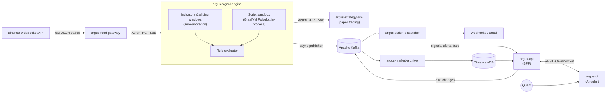

# Argus Quant Engine

> **Event-driven quantitative engine: real-time market data, low-latency signal generation, sandboxed user-defined rules, and a cloud-native deployment on AWS.**

> [!NOTE]
> 🚧 **Status: design phase.** This README describes the target architecture. See the [Roadmap](#-roadmap) for what is built so far.

---

## 📋 Overview

**Argus Quant Engine** is a self-learning portfolio project that rebuilds, at small scale, the kind of pipelines found in Corporate & Investment Banking (CIB) trading platforms. It ingests live market data, computes indicators and evaluates quantitative rules in real time, and distributes the results through two paths: a **low-latency path** (Aeron) for trading consumers and a **durable path** (Kafka) for persistence, alerting and the UI.

The project focuses on three engineering topics:

1. **Low-latency design on the JVM:** single-threaded agents, zero-allocation hot paths, binary encoding (SBE) and shared-memory messaging (Aeron IPC).
2. **Hexagonal architecture:** pure domain models with no framework dependencies, with the architecture rules enforced by tests.
3. **Safe execution of user code:** custom indicators written by users run **inside the engine process**, isolated with the GraalVM Polyglot sandbox.

The whole platform runs locally with Docker Compose and is deployed **end-to-end on AWS** with Terraform.

### Goals

- Build an end-to-end pipeline that works, from the exchange feed to the dashboard.
- Measure latency honestly (HdrHistogram, JMH) instead of claiming it.
- Practise production concerns: schemas and contracts, observability, CI/CD, infrastructure as code.

### Non-goals

- **No real order execution.** Trading consumers are simulated (paper trading).
- It is not an Order Management System (OMS) and does not offer production-grade HA or disaster recovery.
- No co-location or kernel-bypass networking. The market feed comes over the public internet, so end-to-end latency is dominated by the exchange connection. Latency targets apply **inside the pipeline**.

---

## 🏗️ Architecture

### Dual-path streaming

| Path | Transport | Encoding | Used for |
| :--- | :--- | :--- | :--- |
| **Fast path** | Aeron (IPC within a host, UDP unicast between hosts) | SBE (Simple Binary Encoding) | Ticks into the engine, and signals out to trading consumers |
| **Durable path** | Apache Kafka | Protobuf + Schema Registry | Archiving, alerting, rule distribution, UI streaming |

The engine never blocks on Kafka. Results are written to an in-memory Agrona ring buffer, and a dedicated publisher thread drains it into Kafka. Slow brokers or consumers therefore cannot affect the fast path.

### System diagram



---

## 🧩 Components

| Component | Type | Tech | Responsibility |
| :--- | :--- | :--- | :--- |
| **`argus-feed-gateway`** | Service | Spring Boot, Java WebSocket client, Aeron | Connects to Binance public streams, normalises trades into SBE messages and publishes them over Aeron. Handles reconnection and sequence-gap detection. |
| **`argus-signal-engine`** | Service | Spring Boot (bootstrap only), Aeron, Agrona, GraalVM Polyglot | Core of the system. Maintains sliding windows and candles, computes built-in indicators, runs user scripts in the embedded sandbox, and evaluates rules. Emits signals over Aeron and events to Kafka. |
| **`argus-script-runtime`** | Library | GraalVM Polyglot (GraalJS) | Sandboxed execution of user-defined indicators, embedded in the signal engine. Applies isolation and resource limits, and manages the script lifecycle. |
| **`argus-strategy-sim`** | Service | Spring Boot, Aeron | Reference fast-path consumer. Subscribes to signals, simulates order fills and tracks a paper portfolio. It also records the signal-to-reaction latency. |
| **`argus-action-dispatcher`** | Service | Spring Boot, Resilience4j | Consumes alert events and runs actions (webhooks, email) with retries, circuit breakers and a dead-letter topic. |
| **`argus-market-archiver`** | Service | Spring Boot, Spring Kafka, JDBC | Persists ticks, candles, signals and alerts into TimescaleDB hypertables in batches. |
| **`argus-api`** | Service | Spring Boot, Spring Security (OAuth2), WebSocket | Backend-for-Frontend. Rule and script management (CRUD + validation), historical queries, and live streaming of Kafka events to the UI. |
| **`argus-ui`** | Web app | Angular, TypeScript, TradingView Lightweight Charts | Real-time dashboard: live charts, signals and alerts, plus a rule and script editor. |
| **`argus-contracts`** | Library | SBE schemas, Protobuf | Single source of truth for all message contracts. Generates the codecs used by every service. |

---

## ⚡ Inside the signal engine

### Hot path

- **Single-threaded agents** (Agrona `AgentRunner`), each pinned to its own thread with a busy-spin or back-off idle strategy. Locks are never taken on the hot path.
- **Zero allocation in steady state.** Windows are pre-allocated primitive ring buffers (no boxed collections). SBE flyweights decode messages without creating objects. Allocation rate is checked with JFR.
- **Kafka is decoupled** through an Agrona ring buffer and a separate publisher agent (see above).
- **GC:** Generational ZGC, so that the remaining pauses stay short.

### Embedded script sandbox

User-defined indicators are written in **JavaScript** and run **in-process** through the GraalVM Polyglot API. There is no network hop and no serialisation on the evaluation path.

- **Isolation:** scripts run in a polyglot context with no host access, no I/O and no threads, configured through GraalVM's `SandboxPolicy`. The stronger policies (`ISOLATED`, `UNTRUSTED`) run scripts in a separate isolate heap and require Oracle GraalVM, which is free to use under the GFTC licence.
- **Resource limits:** per-evaluation limits on statements, CPU time and heap.
- **Fault containment:** scripts run on their own evaluator agent, so a slow script cannot stall the built-in indicators. If a script fails repeatedly or exceeds its budget, its rule is disabled (circuit breaker) and an alert is raised. The engine keeps running.
- **Two tiers:** built-in indicators (SMA, EMA, RSI, VWAP, Bollinger bands…) are plain Java and run on the fast path. Scripts trade a little latency for flexibility.

### Rules

Rules are declarative JSON definitions that combine indicators, scripts, thresholds and actions. A rule follows this lifecycle:

1. It is created and validated through `argus-api` and stored in PostgreSQL (the same TimescaleDB instance, in regular tables).
2. It is published to the **compacted** Kafka topic `argus.rules.v1`.
3. The signal engine consumes that topic and swaps in an immutable rule set **outside the hot path**. On restart, it rebuilds its full rule state from the compacted topic.

### Where Spring is (and is not) used

Spring Boot is used in every service for configuration, lifecycle, health checks (Actuator), metrics and the Kafka and REST adapters. **In the signal engine, Spring only wires and starts the agents.** The hot path runs as plain Java on dedicated threads, with no beans, proxies or reflection involved. A real ultra-low-latency system would probably drop Spring entirely. It is kept here on purpose, as a learning goal, and confined to the edges.

---

## 🔷 Hexagonal architecture

Every service follows the same structure:

```text
com.argus.<service>
├── domain        # Pure Java: models, value objects, domain logic. No Spring, no I/O.
├── application   # Use cases + ports (inbound/outbound interfaces).
├── adapter
│   ├── in        # Aeron subscribers, Kafka consumers, REST/WebSocket controllers
│   └── out       # Aeron publishers, Kafka producers, JDBC repositories, HTTP clients
└── config        # Spring wiring (the only package allowed to depend on adapters)
```

**ArchUnit** tests enforce the dependency rules in CI. For example, `domain` must not depend on Spring, Aeron or Kafka. The same rule is what keeps the signal engine's hot path free of framework code.

---

## 📨 Contracts

| Channel / Topic | Transport | Schema | Description |
| :--- | :--- | :--- | :--- |
| `aeron:ipc` stream 1001 | Aeron | SBE `Trade` | Normalised trades from the feed gateway |
| `aeron:udp` stream 2001 | Aeron | SBE `Signal` | Signals for fast-path consumers |
| `argus.market.trades.v1` | Kafka | Protobuf | Normalised trades (archive) |
| `argus.market.candles.v1` | Kafka | Protobuf | 1s / 1m candles |
| `argus.signals.v1` | Kafka | Protobuf | Signals emitted by rules |
| `argus.alerts.v1` | Kafka | Protobuf | Alerts that trigger actions |
| `argus.rules.v1` | Kafka (compacted) | Protobuf | Current rule and script definitions |
| `argus.alerts.dlq.v1` | Kafka | Protobuf | Actions that failed after retries |

---

## 🛠️ Tech stack

| Concern | Local | AWS |
| :--- | :--- | :--- |
| **Runtime** | Java 25 (LTS): Eclipse Temurin; Oracle GraalVM 25 for the signal engine | Same container images, published to Amazon ECR |
| **Framework** | Spring Boot 4 | — |
| **Fast-path messaging** | Aeron + Agrona + SBE, Media Driver sidecar, shared IPC namespace in Docker | ECS on EC2 with `ipcMode: task` (IPC is not available on Fargate). UDP unicast between hosts, because VPCs do not support multicast |
| **Event streaming** | Apache Kafka (KRaft) | Amazon MSK (managed Apache Kafka, same client APIs) |
| **Schema registry** | Apicurio Registry | AWS Glue Schema Registry |
| **Time-series storage** | TimescaleDB | TimescaleDB self-managed on EC2 + EBS (RDS and Aurora do not support the TimescaleDB extension) |
| **Authentication** | Keycloak (OIDC) | Amazon Cognito (OIDC) |
| **Notifications** | Webhook mock server, MailHog | Amazon SES / outbound webhooks |
| **Frontend hosting** | `ng serve` | Amazon S3 + CloudFront |
| **API exposure** | Docker network | Application Load Balancer (REST + WebSocket) |
| **Observability** | OpenTelemetry + Micrometer → Grafana LGTM stack (`grafana/otel-lgtm`) | OpenTelemetry (ADOT collector) → Amazon CloudWatch |
| **Infrastructure as code** | Docker Compose | Terraform |
| **CI/CD** | GitHub Actions | GitHub Actions → ECR → ECS (OIDC role, no long-lived keys) |
| **Build** | Maven multi-module build (Maven Wrapper) | — |
| **Testing** | JUnit 5, Testcontainers, ArchUnit, JMH | — |

### AWS deployment overview

- **VPC** with public subnets (ALB) and private subnets (services, MSK, database).
- **ECS cluster** with two capacity types:
  - **EC2 capacity provider** for the fast path: the feed gateway, the signal engine and a Media Driver sidecar run in the same task and share IPC.
  - **Fargate** for everything else.
- **MSK** for Kafka, **EC2** for TimescaleDB, **Cognito** for authentication, **S3 + CloudFront** for the UI.
- **Cost:** MSK and the EC2 instances are billed while they run, so the environment is meant to be created with `terraform apply` and destroyed with `terraform destroy` after each session.

---

## 📈 Performance targets

These are **targets, not measured results.** They will be replaced by real numbers (HdrHistogram percentiles) as each phase is benchmarked.

| Measurement | Scope | Target (p99) |
| :--- | :--- | :--- |
| Trade decoded → signal emitted | Inside `argus-signal-engine`, built-in indicators | < 50 µs |
| Feed gateway → signal engine | Aeron IPC, same host | < 20 µs |
| Script evaluation | GraalJS, warmed up, simple indicator | < 500 µs |
| Engine → strategy simulator | Aeron UDP, same AZ | < 500 µs |

Cloud VMs have more jitter than dedicated hardware. Results are reported together with the environment they were measured on.

---

## 📁 Repository layout (planned)

```text
argus-quant-engine/
├── contracts/            # argus-contracts: SBE + Protobuf schemas
├── libs/
│   └── script-runtime/   # argus-script-runtime
├── services/
│   ├── feed-gateway/
│   ├── signal-engine/
│   ├── strategy-sim/
│   ├── action-dispatcher/
│   ├── market-archiver/
│   └── api/
├── ui/                   # argus-ui (Angular)
├── benchmarks/           # JMH + latency harnesses
├── infra/
│   ├── docker/           # docker-compose for local development
│   └── terraform/        # AWS infrastructure
└── docs/
    └── adr/              # Architecture Decision Records
```

---

## 🗺️ Roadmap

- [ ] **Phase 0: Foundations.** Maven multi-module build, `argus-contracts`, Docker Compose (Kafka, TimescaleDB, Apicurio, Grafana), GitHub Actions CI, ArchUnit rules.
- [ ] **Phase 1: Vertical slice.** Feed gateway → signal engine (candles + SMA/EMA) → Kafka → archiver → TimescaleDB.
- [ ] **Phase 2: Rules & alerts.** Rule model, compacted rules topic, action dispatcher with Resilience4j.
- [ ] **Phase 3: Script sandbox.** `argus-script-runtime` with GraalJS, resource limits and a circuit breaker.
- [ ] **Phase 4: API & UI.** `argus-api` (REST, WebSocket, OIDC) and the Angular dashboard.
- [ ] **Phase 5: Fast-path consumer & benchmarking.** `argus-strategy-sim`, JMH and HdrHistogram harnesses, real latency numbers in this README.
- [ ] **Phase 6: AWS.** Terraform modules, ECS (EC2 + Fargate), MSK, Cognito, CloudFront, CD pipeline.
- [ ] **Phase 7: Observability.** End-to-end tracing, dashboards, SLO-based alerting.

Key design decisions are recorded as ADRs in [`docs/adr`](docs/adr).

---

## 📄 License

See [LICENSE](LICENSE).
